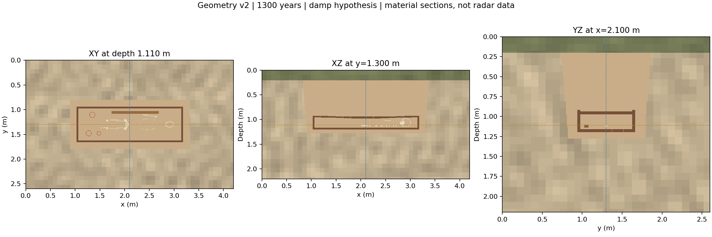

# Burial GPR Laboratory

An interactive subsurface model builder and reproducible **gprMax** simulation toolkit for archaeological coffin burials.

Build a procedural burial, explore linked horizontal and vertical material sections, and export full-wave electromagnetic experiments from **100 MHz to 2 GHz**. The browser app runs as a static website without an account or server backend. Electromagnetic propagation runs separately in Python with gprMax.

## What it does

- Orbitable 3D geometry with a software-rendering fallback.
- Detailed procedural skeleton: cranial and pelvic shells, curved ribs, vertebrae, joint ends and hollow long bones.
- Coffin boards, a stepped grave shaft, corrosion geometry and shaped hollow vessels.
- Linked **XY, XZ and YZ sections**, positioned by sliders, exact coordinates, crosshairs or 3D handles.
- Moisture-dependent dielectric mixing, conductivity and passive Debye material fits.
- Seeded soil heterogeneity shared by the browser and Python exporter.
- 2D and 3D gprMax inputs, matched background models, and trace/line-spacing comparisons.



These are material sections, not measured or simulated radar images.

## Run the model builder locally

The browser builder needs only a web server. It does not require the Python scientific packages or Node.js.

```bash
python scripts/build_release.py
python -m http.server 8000 --bind 127.0.0.1 --directory web
```

Open **http://localhost:8000**. `build_release.py` creates the downloadable Python toolkit used by the website's download button. Do not open `index.html` directly through `file://`, because browsers restrict module and JSON requests in that mode.

No npm installation or JavaScript build step is required. Three.js is vendored under its own MIT licence. Fonts use the browser's local font stack, so the app does not depend on a font CDN.

### Position a section

| Section | Fixed coordinate |
|---|---|
| Horizontal XY | Depth below the ground surface |
| Longitudinal XZ | y coordinate |
| Transverse YZ | x coordinate |

Drag a crosshair or change the coordinate controls to move the linked sections. **Use for GPR** selects a vertical plane for the exported survey. **Focus on burial**, zoom, **Show lid** and **Section planes** change the inspection display; hidden infill remains in the simulation geometry. Section positions are saved in the exported `model.json`.

## Share a live version with GitHub Pages

1. Create a GitHub repository named **burial-gpr-laboratory** and upload this repository's contents, including `.github/`.
2. In **Settings → Pages → Build and deployment**, choose **GitHub Actions** as the source.
3. Open **Actions → Deploy model builder → Run workflow**.

The included workflow builds the toolkit download and publishes `web/`. Subsequent pushes to `main` also deploy it. The live URL appears in the deployment and in Settings → Pages. A public Pages deployment lets colleagues use the model builder without a ChatGPT login.

GitHub's instructions: [Using custom workflows with GitHub Pages](https://docs.github.com/en/pages/getting-started-with-github-pages/using-custom-workflows-with-github-pages).

### Publish from a local checkout

After creating an empty repository on GitHub, use the remote URL GitHub provides. Alternatively, with the GitHub CLI installed and authenticated, from this folder:

```bash
git init -b main
git add .
git commit -m "Initial release of Burial GPR Laboratory"
gh repo create burial-gpr-laboratory --public --source=. --remote=origin --push
```

`--public` publishes the code openly. Use `--private` instead if you want to review or share it with selected collaborators first. Enable Pages as described above when ready to host the browser app.

## Generate GPR simulations

Use Python **3.11–3.13**, preferably Python 3.12. Create and activate a virtual environment first, then:

```bash
python -m pip install -r toolkit/requirements.txt
python toolkit/burial_gpr.py estimate toolkit/quickstart.json
python toolkit/burial_gpr.py generate toolkit/quickstart.json --out runs/first_coffin
python toolkit/burial_gpr.py run runs/first_coffin --limit-traces 3 --threads 4
python toolkit/burial_gpr.py collect runs/first_coffin
```

The trace limit is a workflow test at the start of the profile, not full coverage of the burial. Omit it for a complete acquisition. Substitute an exported project JSON for `quickstart.json` to use your own model.

The browser is a geometry/material editor; it does **not** run full-wave GPR propagation. Fine 3D models can require substantial RAM and runtime. Estimate first and establish mesh, boundary and time-window convergence before interpreting results.

Detailed physics, taphonomy assumptions, command examples and sampling analysis are in [toolkit/README.md](toolkit/README.md).

## Scientific status

The geometry is an editable procedural approximation, not a scan or a reconstruction of a measured individual. Preservation half-lives and scenario presets are illustrative hypotheses. Age alone does not establish coffin survival, skeletal preservation or electromagnetic properties.

The 2D solver implies infinite extent normal to the selected plane; it cannot establish finite 3D skeletal detectability. Sources are ideal dipoles rather than models of commercial antennas. Material properties need site-specific calibration.

The included verification traces were actually computed with gprMax 4.0.1 on a deliberately under-resolved mesh. They demonstrate the export/solve/analysis pipeline and are labelled accordingly. They are not convergence results or evidence of detectability. Initial implementation used AI assistance; independent scientific review remains necessary.

## Validate or contribute

Python dependencies above and Node.js 22 or newer are needed for the complete checks:

```bash
python -m unittest discover -s toolkit -v
python scripts/test_geometry_parity.py
python scripts/check_web.py
```

The checks cover material passivity, dielectric endmembers, decay limits, deterministic geometry, sampling metrics, shared anatomy, shared soil fields, exact browser/Python section maps and selected-plane export. GitHub Actions runs these checks for pushes and pull requests.

See [CONTRIBUTING.md](CONTRIBUTING.md). Changes to anatomy or materials should preserve agreement between the browser and Python representations.

## Repository layout

| Directory | Contents |
|---|---|
| `web/` | Static browser app and vendored renderer |
| `toolkit/` | Generator, examples and numerical tests |
| `scripts/` | Anatomy generation, checks and release packaging |
| `.github/workflows/` | Checks and GitHub Pages deployment |


## Licence and citation

Project-authored code, procedural templates and included synthetic examples are distributed under the [MIT licence](LICENSE). Third-party software retains its own licence; see [THIRD_PARTY_NOTICES.md](THIRD_PARTY_NOTICES.md). gprMax is an external dependency and is not bundled or relicensed here.

Citation metadata is supplied in [CITATION.cff](CITATION.cff). For published simulations, also cite gprMax and the relevant material/archaeological sources listed in the modelling documentation. This repository has no assigned DOI.
